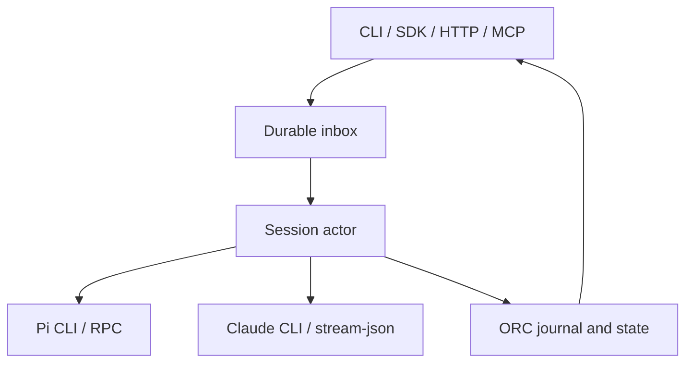

# orc — Architecture

orc runs coding agents (`claude`, `pi`) as durable sessions for other agents to drive.
Each session is a small **actor process** that drives its provider over a **structured
protocol** and records every fact in a **journal**. Claude and Pi are their own CLIs. Pi supplies
OpenAI/Codex model access through its model-provider layer; there is no ORC-owned model/tool
harness. There is no terminal or screen scraping. Agents hold the reins; humans observe (`read`, `attach`) or take over
(`takeover` → `resume`).

This page describes the system as built. [`DESIGN-runtime.md`](DESIGN-runtime.md) has the
rationale, the options rejected and the implementation notes; [`DESIGN-workflows.md`](DESIGN-workflows.md)
and [`DESIGN-daemon.md`](DESIGN-daemon.md) cover workflows and the daemon. `RESEARCH.md` is the
historical (tmux-era) research log.
The [Pi migration guide](MIGRATION-pi.md) covers the removed dedicated Codex harness and preserved
historical data. The [pi-durable decision](decisions/pi-durable.md) records why ORC keeps its
shared session and workflow durability.

## Stack

- Bun (TypeScript, ESM), `engines.bun >= 1.3.3`. Ships from source or as one binary
  (`bun build --compile`). The kernel uses `Bun.spawn` pipes, `node:fs`, `util.parseArgs`. Runtime
  dependencies, all pinned exactly: `@modelcontextprotocol/server` 2.3.1 + `zod` 4 for `orc mcp` /
  the daemon's `/mcp` (loaded lazily, so other commands and actors never import them).
- The only external executables are the claude and pi CLIs (plus `git` for workspace discovery and worktrees, and
  `tailscale` for the daemon). Pi library code is owned by the installed Pi distribution, not
  bundled in ORC. No `pi-durable` dependency or storage migration is introduced.
- macOS and Linux. Process identity is pid + start time (Linux `/proc/<pid>/stat`, macOS
  `ps -o lstart=`), so a reused pid is never mistaken for a live process.

## Process model



- Clients never talk to the actor directly. They write `spawn.json`/`state.json` under the
  `actor-<sid>` lock, drop items into the inbox, spawn (wake) the actor, and read the journal.
  Every call is safe from any process and survives the caller's exit.
- The actor is `orc __actor <sid>`, re-executed from the running build (compiled binary, or
  `bun src/cli/index.ts`) and spawned detached: new session, no controlling terminal, stdio →
  `actor.log`. It survives its launcher.
- The provider runs in **its own process group** over pipes. Stopping kills the group.

The layers have separate responsibilities:

| Layer | Owns |
| --- | --- |
| ORC integration (`pi` or `claude`) | Detached processes, protocol normalization, mailbox/delivery receipts, session ownership, workflow orchestration |
| Pi CLI and agent runtime | Agent loop, tools/extensions, compaction, CLI session files, RPC commands |
| Pi model-provider libraries | Model catalog, provider requests, supported authentication and token refresh; `openai` and `openai-codex` are distinct Pi providers |
| Claude CLI | Its existing native agent loop, settings, authentication and transcripts |

## Session kernel (`src/runtime/`)

| file | role |
| --- | --- |
| `spec.ts` | `spawn.json`: everything needed to (re)start from cold — provider, cwd, env additions, model, agent, system prompt file, provider session id, transcript path |
| `actor-state.ts` | `state.json`: phase, lease, provider identity, start-failure counter; per-session locks |
| `inbox.ts` | durable mailbox: `inbox/<ULID>.json` items `message` / `interrupt` / `stop` (tmp + rename) |
| `journal.ts` | append-only JSONL facts with a monotonic `seq`; torn tails repaired |
| `derive.ts` | pure folds: turns, `AgentState`, delivery verdicts, stale providers |
| `client.ts` | the API the rest of orc uses: `createSession`, `send`, `interrupt`, `stop`, `reopen`, `ensureAwake`, `inspect` |
| `actor-main.ts` | the actor loop |
| `process.ts` | `spawnDetached`, process identity, group kill, self re-exec argv |
| `providers/` | one runtime per provider + a scripted `fake` for tests |

**Lease.** `state.json.lease = {pid, startTime, token, expiresAt}`, heartbeat 5 s, TTL 30 s,
written tmp + rename under the `actor-<sid>` lock. Live = lease unexpired ∧ same process alive.
One live lease per session = one writer.

**Actor loop.** Acquire the lease → kill any recorded stale provider group → repair the journal
tail and close an intent with no outcome as `turn.interrupted{recovered}` (never re-sent) → start
or resume the provider (`actor.started`, `provider.spawned`, `provider.ready`) → consume the inbox
strictly in ULID order, one turn at a time (polling every 250 ms is the correctness path;
`fs.watch` is a latency hint) → on exit kill the provider group and release the lease.

**Journal vocabulary.** `actor.started`, `provider.spawned`, `provider.ready`, `inbox.accepted`,
`inbox.dropped`, `turn.intent`, `turn.started`, `assistant.text`, `interrupt.requested`,
`interrupt.acked`, `turn.completed`, `turn.failed`, `turn.interrupted`, `permission.requested`,
`provider.exited`, `actor.stopped`, `actor.reopened`. Intent and outcome entries are fsync'd.
Verbatim provider traffic goes to `provider.jsonl` (debug only), not the journal.

**Effect sandwich.** `turn.intent{messageId, text}` is committed before the message is written to
the provider; `turn.started` is the provider's ack; the outcome follows. A crash between intent
and ack makes the delivery `unknown`: never resubmitted automatically.

**Send.** `send(sid, {messageId, text})` is idempotent per `messageId` (inbox item or journal
intent). It enqueues, wakes a suspended session (unless `wake: false`), and waits up to 10 s for
`turn.started`: `acknowledged`, else `queued`. A stopped session refuses it; a message still
queued when a stop lands is dropped with `inbox.dropped` (verdict `failed`).

**Stop, suspend, wake.**

| phase | cause | wakes? |
| --- | --- | --- |
| `stopped` | stop item (`orc kill`, `orc takeover`, `prune --suspended`) | never, until `reopen()` (`orc resume`) |
| `suspended` | actor gone without a stop: provider exit, SIGTERM, crash, reboot | on the next send, `orc resume`, or workflow resume |

Waking takes the `actor-<sid>` lock, re-checks `maxConcurrentSessions`, kills a wedged actor
(alive, lease expired) and every unexited provider recorded in `state.json` or the journal, then
spawns the actor in resume mode; concurrent senders yield one actor. After 3 consecutive starts
that never reached `ready`, auto-wake is refused until a forced wake (`orc resume`). An actor that
dies mid-stop leaves `stopping`; the next lock holder finishes the stop (it stays sticky).

**Takeover / resume.** `takeover` stops the actor (sticky, so no second writer can wake), waits for
the provider group to exit, and returns the provider's native resume command
(`src/provider-cli.ts`). `resume` journals `actor.reopened`, clears the stop, force-wakes, and
waits for `ready`.

## Provider runtimes (`src/runtime/providers/`)

`ProviderRuntimeFactory.start(launch)` spawns the provider process (detached, pipes) and returns a
`ProviderRuntime`: `send(messageId, text)`, `interrupt()`, `close({graceMs})`, and one async stream
of normalized events (`ready`, `turn.started`, `assistant.text`, `turn.completed|failed|interrupted`,
`interrupt.acked`, `permission.requested`, `exited`). Outcomes come from protocol events, never exit
codes. Each runtime appends its raw protocol lines to `provider.jsonl`.

| | claude | pi |
| --- | --- | --- |
| process | `claude -p --input-format stream-json --output-format stream-json --verbose --replay-user-messages --permission-mode bypassPermissions --setting-sources user,project,local` | `pi --mode rpc -a` |
| fresh / resume | `--session-id <sid>` / `--resume <sid>` | same flags both ways: `--session-id` + `--session-dir` |
| system prompt | `--append-system-prompt-file` / `--system-prompt-file` | `--append-system-prompt` / `--system-prompt` `<file>` |
| ready | `initialize` control response | `get_state`; explicit qualified models also require matching Pi `get_available_models` |
| ack | `command_lifecycle started` (fallback: replayed user echo) | `prompt` response |
| outcome | `result` (`terminal_reason` / `is_error`) | `agent_settled` |
| interrupt | `control_request interrupt` | `abort` |
| reference CLI version | 2.1.300 | 1.2.0 |

Wire types are vendored and version-pinned (`*-protocol.ts`); contract tests pin each mapping.
For `model: "openai/gpt-5.5"`, ORC passes `--provider openai --model gpt-5.5` to Pi. It checks
the selected provider/ID and its membership in Pi's configured available-model list before
publishing readiness; an explicit unknown, unavailable or substituted model fails startup.
Pi owns that catalog and credentials; ORC keeps no model catalog or authentication store.
Bare Pi aliases/patterns retain Pi's resolution. Custom model IDs are configured in Pi.

The `openai` provider in Pi 1.2.0 supports both `OPENAI_API_KEY` and `/login openai` →
**Sign in with ChatGPT**. Its `openai-codex` backend remains a separate Pi provider with separate
authentication, not a compatibility alias. See [the pinned upstream references](MIGRATION-pi.md#install-and-authenticate-pi).

Claude strips inherited `CLAUDE_CODE_*` variables except auth/backend settings
(`ORC_CLAUDE_KEEP_ENV` adds more). Permission requests in yolo mode are journaled, then denied.

The removed `src/codex/` harness, protocol adapter, custom tools, login/refresh/model-discovery
code, direct pi-ai/pi-agent-core dependencies and harness-specific build/test hooks have no
production replacement inside ORC. Pi's existing CLI supplies those behaviours.

## Session layer (`src/`)

- **`agent()`** (`agent.ts`): validate options → resolve the agent body / system prompt
  (`agentdefs.ts`) → reserve the registry record (alias + policy checks under a root lock) →
  optional worktree (`<repo>/.orc/worktrees/<id>`, branch `orc/<label>/<id>`) → write the system
  prompt file (0600) → `createSession` (spawn.json + actor) → wait for `provider.ready`
  (`readyTimeoutMs`, default 60 s) → send the initial prompt through the inbox. Any failure before
  ready stops the actor and removes the session dir, worktree and record.
- **`Session`** (`session.ts`): a `SessionRecord` plus kernel calls. `state()`/`stateDetail()` derive
  from the journal; `waitFor()` polls every 250 ms and returns on the first match; `send()`,
  `interrupt()`, `journal()`, `attach()` (journal follower), `kill()`, `takeover()`, `resume()`,
  `readParsed()` (provider transcript via `transcript.ts`).
- **State** (`runtime/derive.ts` `deriveState`), by precedence: missing / stopped / not live →
  `failed` (with `stopped` or `suspended`); actor `starting` → `starting`; pending permission →
  `waiting`; open turn or queued message → `running`; last turn failed → `failed`; else `done`.
- **Status** (`session-status.ts`): `running` (lease live), `suspended` (not live, not stopped,
  spawn.json present), `spawning` (a record younger than 10 min without spawn.json: listed,
  counted against concurrency, never pruned; `state` reads `starting`), `dead` (stopped, legacy,
  marked dead, an unsupported historical session, or no spawn.json past the grace).
- **Prune** (`index.ts` `pruneSessions`): re-judges each candidate under its `actor-<sid>` lock and
  removes the record and dir while holding it, so a concurrent `orc resume` (reopen under the same
  lock) either wins or finds nothing. Keeps running/spawning; suspended only with `--suspended`
  (its stop is finalised in that lock section); taken-over sessions only with `--taken-over`.
- **Registry** (`registry.ts`): `~/.orc/registry.json`, an array of `SessionRecord`, mutated under
  a lock and written atomically. Records persist only `status: 'dead'`; everything else comes from
  the kernel. Pre-actor records normalise to `dead` + `legacy: 'tmux'` (readable, never controlled).
- **Workspaces and aliases**: workspace = explicit key, else git toplevel, else realpath(cwd);
  `@alias` resolves among active (running/suspended) records of a workspace.
- **Transcripts** (`provider-cli.ts`): claude `~/.claude/projects/*/<id>.jsonl`; pi
  `get_state.sessionFile` or `<sessionDir>/*_<id>.jsonl`. `orc read` falls back to the journal
  when none exists yet. Historical `codex-session.jsonl` files remain readable through the Pi
  transcript parser; this does not retain their execution implementation.
- **Removed-provider compatibility**: historical `provider: 'codex'` values remain data in
  records/specs/runs. No automatic conversion or prompt replay occurs. New Codex inputs and
  historical `send`/`resume` fail with migration guidance. A harness-session `takeover` stops
  any old actor, verifies its Pi v3 transcript identity, then prints native Pi `--session`
  continuation with `--provider openai`, the active branch's model and its explicit prompt/cwd. A
  missing persona file or unusable migration metadata produces an error. The historical ORC
  session is not handed back to a new executor. Old app-server rollouts have no automatic
  importer. See [migration](MIGRATION-pi.md#existing-sessions).

## CLI and daemon

- **CLI** (`src/cli/`): a `util.parseArgs` dispatcher over the SDK. Every command takes `--json`;
  errors are `{error}` on stdout with exit 1; `send` exits 3 for `unknown`. `--host <h>` turns a
  command into an HTTP call to that host's daemon. Full surface: `orc help` and the README.
- **Daemon** (`src/daemon/`): `Bun.serve` exposing the SDK as JSON (`/sessions…`, `/workflows…`,
  `/health`, `/whoami`), bound to the tailscale IP by default. Auth is fail-closed and scoped
  (tailnet allowlist, bearer tokens, legacy secret). `GET /health` reports `api: 2`; raw reads
  return the journal. Errors map to statuses (`httpStatusFor`): 400 invalid request, 403 policy
  violation, 404 `ORC_SESSION_UNKNOWN` / unknown run, 409 `ORC_SESSION_STOPPED` /
  `ORC_MESSAGE_CONFLICT` / `ORC_SESSION_LEGACY` / run state, 502 `ORC_SESSION_START_FAILED`,
  else 500. The `--host` client still reads v1 (`pane`, `submitted`) answers. Details:
  `DESIGN-daemon.md`.
- **MCP** (`src/mcp/`): `orc mcp` (stdio) and the daemon's `/mcp` (Streamable HTTP, stateless)
  serve orc's agent-facing commands as MCP tools. Each tool call re-runs this binary as
  `orc … --json` (argv only, never a shell; at most 32 at once), so the CLI's `--json` output is the
  tool contract. On the daemon every call runs `--local`, tools are filtered by the caller's
  scopes, `Host`/`Origin` must name the daemon, and daemon credentials never reach the children.
  The lead-agent instructions and the `guide` playbook live in `src/mcp/instructions.ts` and
  `src/mcp/guide.ts`.
- **Human output** (`src/style.ts`, `src/terminal-text.ts`): renderers are pure string builders
  that take an optional style (plain by default, so SDK and MCP text never carry ANSI). The CLI
  colours a stream only when it is a TTY (`--color`, `NO_COLOR`, `FORCE_COLOR` override), never
  with `--json`, and strips terminal control sequences from agent text written to a TTY.

## Workflows

- **Runs** (`runs.ts`, `run-schema.ts`): `~/.orc/runs/<runId>.json`, schema 5, monotonic `revision`,
  CAS writes under a run lock. The validated plan and its digest are persisted before any side
  effect; attempts record phases `queued → spawning → dispatched → running → verifying →
  succeeded|failed|waiting|cancelled|abandoned` (+ scheduler-owned `blocked`/`skipped`);
  each transition is emitted once, forward only.
- **Runner** (`workflow.ts`, `workflow-scheduler.ts`): a bounded DAG launch loop
  (`min(maxConcurrency, policy.maxConcurrentSessions)`); each step spawns an agent, delivers its
  instructions (over 1 KiB → file under `~/.orc/runs/<runId>/` + pointer), waits on the journal
  state, then judges success: `done(ctx)`, portable `verify`, or a worktree commit. A bare yield is
  `unverified` and fails closed. `StepDoneCtx.capture` is the last assistant text plus the final
  turn, from the journal (≤ 8000 chars).
- **Detached runners** (`workflow-runner.ts`): `spawnDetached` processes logging to
  `runs/<runId>/runner.log`; the run records `runner: {pid, startTime, logPath, startedAt}` and
  heartbeats an owner lease. Reconcile: lease fresh and runner alive → `running`; else `orphaned`.
  Finalized runs are never downgraded. `cancel` SIGTERMs a live runner.
- **Recovery**: `resume` skips successes and adopts in-flight steps whose instruction reached a
  still-resumable session, but never relaunches around a session a human took over (the attempt
  fails `taken_over` until `orc resume` + `retry`); `retry` appends attempts; `cancel --cascade`
  and `cleanup` only touch sessions proven owned (`rootRunId` / `parentRunId`). Lineage and
  policy propagate through `ORC_*` env vars.
- **Provider migration**: old Codex plans/attempts stay readable, but their provider or digest
  is never rewritten to run a different harness. Update the source definition and start a new
  Pi run with explicit reuse of verified outputs. Pi/Claude-only runs keep the existing
  adoption, retry and cancellation rules. See [migration](MIGRATION-pi.md#existing-workflows).

## Storage and privacy

```
~/.orc/                     (ORC_HOME)             0700
  registry.json, peers.json                         0600
  locks/                                            0700, lock files 0600
  sessions/<sid>/                                   0700
    spawn.json, state.json, journal.jsonl, provider.jsonl, actor.log,
    system-prompt.md, inbox/<ULID>.json              0600
  transcripts/pi/<sid>/                             0700
  runs/<runId>.json                                 0600 (plan holds step prompts)
  runs/<runId>/  runner.log, <step>.md drops, attempts/, artifacts/, inputs/   0700 / 0600
```

The journal holds full prompt and reply text. orc sets these modes explicitly (chmod/fchmod; mkdir
and open modes are umask-filtered) and tightens older state on its next write
(`src/private-fs.ts`). `kill --purge` and `prune` remove a session's dir.
Old Codex credentials, device identity, cached models and Pi-format transcripts are left on
disk. ORC no longer reads/refreshes those credentials or writes the model cache. Pi's auth and
settings belong to Pi's own directory; there is no second ORC credential owner.

Locks (`src/lock.ts`, registry lock) are `open('wx')` files recording `{pid, startTime, host,
token}`. A lock whose owner is provably gone (dead pid, zombie, or a recycled pid with another
start time) is reclaimed on the next poll; one with no recorded owner, or an owner on another host,
after 5 min. Removal happens under `<lock>.cleanup` after re-reading the owner.

## Testing and verification

- `bun test`: pure logic, the kernel against the scripted `fake` provider (crash, torn tail,
  stale-provider kill, two senders → one actor), provider mappers over captured CLI output, the
  Pi model selection, removed-provider/data compatibility, workflows and daemon routes/auth.
  The CLI suite shadows `tmux` on `PATH` and fails if it is called.
- `bun run check:compile`: compiles orc and runs `scripts/verify-runtime/compiled.ts`, using
  isolated state and scripted Pi RPC/Claude stream-json executables to exercise real compiled
  actors and lifecycle controls. CI and Nix reuse this offline smoke test; it is not live model
  validation.
- `bun run typecheck` covers `src`, `test`, `scripts/verify-runtime` and `scripts/dogfood`.
- Live gates, on an authenticated host: `bun run verify:live` (`scripts/verify-runtime/all.ts`) —
  per-provider runtime gates, CLI end-to-end including SIGKILL → suspended → wake and
  takeover/resume, a detached workflow, and "tmux never invoked". Missing binaries or known
  missing credentials are reported as skipped/blocked, never passed live checks. Verification
  preflight delegates auth status to the native CLI without requesting credential values.
